# erp-consolidation-toolkit

[](https://github.com/pJijesh/erp-consolidation-toolkit/actions/workflows/test.yml) [](LICENSE)  

**Problem:** groups that own several companies often run several ERP and finance systems, and the case for moving them onto one platform is usually argued from opinion, while the real risks (duplicate master data, charts of accounts that do not map, balances that do not reconcile) are found late, and sometimes the right answer is not to consolidate at all.

**For:** IT leaders and finance leaders in manufacturing and distribution groups who must decide whether and how to consolidate, and who will own the data work and the cutover.

**Demonstrates:** a scored decision framework (consolidate, partially integrate or keep separate), a method for data migration and cutover, and a small standard-library Python tool that profiles extracts, maps charts of accounts, finds probable duplicate customers, suppliers and parts, reconciles trial balances before and after mapping, and produces a readiness scorecard, all run on a fictional two-company group with committed reports.

All companies, people and figures are fictional: the two manufacturers "Marrowdale Castings Limited" and "Norvane Dichtungen GmbH" are invented for illustration, and any resemblance to a real business is accidental. The example figures are not benchmarks. The text says "ERP A" and "ERP B" and names no product.



> This repository gives general practitioner guidance. It is not legal, tax or accounting advice. Statements about record retention, tax number formats and similar rules are general and were checked against public sources during the build (see Verification status). Take advice for the entities concerned.

## What it does

- **Decision framework** (`decision/`): 13 weighted criteria with written scoring anchors and 4 gates, scored on two axes (case for consolidation, ability to deliver) to give consolidate, partially integrate, keep separate or defer. It lists the weakest criteria, shows which one-point changes would flip the outcome, and includes an honest section on when not to consolidate.
- **Method and guidance** (`docs/`): the four approaches (big bang, phased by entity, phased by module, coexistence with a group reporting layer) and how to choose, the migration steps (extract, cleanse, map, load, reconcile, cutover), a cutover plan with rehearsal checklist, common pitfalls, governance and roles, and a business case outline.
- **Command line tool** (`python -m erp_consol`), which reads CSV extracts and never touches a source system:
  - `profile`: row counts, missing values, repeated keys and format checks (postcode, tax number, email, date, number, regular expression) per column.
  - `map-coa`: applies a manual chart mapping first, then suggests the rest from account type and normalised name similarity with a confidence score, flags unmapped and many-to-one accounts, and writes a mapping file and an exceptions list.
  - `dedupe`: scores probable duplicate customers, suppliers or parts within and across two systems with a documented additive model and three bands (automatic, review, none), and writes a match report and a merge proposal. No data is changed.
  - `reconcile`: compares trial balances before and after the mapping, by period, with a tolerance, including movement between account classes and an optional comparison with a trial load of the target.
  - `readiness`: combines the summaries into a NO-GO, CONDITIONAL GO or GO scorecard with documented thresholds.
  - `decide`: scores the decision framework.
- **Worked example** (`examples/`): synthetic extracts for two fictional manufacturers in one group (charts of 81 and 110 accounts with different numbering, customer, supplier and part masters with planted duplicates, two trial balances), the answers the generator planted, and every report committed.

## Quick start

Requires Python 3.10 or later. No third-party packages.

```bash
pip install -e .          # optional: gives the erp-consol command. python -m erp_consol works from a checkout

# 1. Profile an extract (ERP B uses semicolons and Windows-1252, detected automatically)
python -m erp_consol profile examples/data/erp_b_customers.csv \
  --config examples/config/erp_b_customers.json --out output/profile

# 2. Map a chart of accounts (manual mapping first, suggestions for the rest)
python -m erp_consol map-coa --source examples/data/erp_b_chart.csv --target examples/data/target_chart.csv \
  --manual examples/data/erp_b_manual_mapping.csv --tb examples/data/erp_b_trial_balance.csv \
  --source-map account=gl_code,name=gl_description,type=class --target-map account=account \
  --tb-map account=gl_code --decimal-comma --name erp_b --out output/coa

# 3. Find probable duplicate customers across both systems
python -m erp_consol dedupe --entity party \
  --a examples/data/erp_a_customers.csv --b examples/data/erp_b_customers.csv \
  --a-map id=cust_id,name=cust_name,postcode=postcode,tax=vat_no,country=country,email=email,city=city \
  --b-map id=account_no,name=account_name,postcode=zip,tax=tax_id,country=country_code,email=contact_email,city=town \
  --name customers --out output/dedupe

# 4. Score the consolidation decision
python -m erp_consol decide --scores decision/examples/two-manufacturers.csv --out output/decision
```

Output from those runs:

```text
erp_b_customers: 42 rows, 9 columns, format invalid rate 0.0649, key duplicate rate 0.0952
erp_b: 110 source accounts, 55 approved, 34 suggested, 21 unmapped, 21 error and 18 warning exceptions
customers: 94 records, 16 automatic pairs, 10 for review, 16 proposed merge groups
two-manufacturers: PARTIALLY INTEGRATE (case 57.7, ability 29.7)
```

The reconcile and readiness commands, and every other command and option, are in [docs/commands.md](docs/commands.md). To regenerate the whole committed example, run `python examples/generate_examples.py` then `python examples/run_examples.py`. Reports are in [`examples/reports/`](examples/reports/), for example the [readiness scorecard](examples/reports/readiness/group-readiness-report.md), which is NO-GO (20 red, 8 amber, 6 green) for the messy example data by design.

Exit status is 0 on success, 2 for a problem with the input (the message names the file and the problem) and 3 when a requested gate such as `--fail-on-no-go` is not met.

## What the example shows

| Area | Result on the fictional data |
|---|---|
| Customers | 94 records, 16 proposed merge groups (9 span both systems), 10 pairs for review |
| ERP A chart | 78 of 81 accounts approved (96.3%). The mapping moves some balances between account classes and the reconciliation shows it |
| ERP B chart | 55 of 110 approved, 34 suggested, 21 unmapped. Reconciliation on approved mappings alone fails in all three periods |
| Chart suggester, no manual file | High-confidence suggestions right in 73 of 75 cases, low-confidence in 41 of 55 (planted answers in `examples/truth/`) |
| Readiness | NO-GO, 20 red, 8 amber, 6 green |
| Decision | Two manufacturers: partially integrate. Two UK distributors: consolidate. Different regulated businesses: keep separate |

## How it is built

```text
.
├── README.md
├── LICENSE                          MIT
├── CONTRIBUTING.md
├── pyproject.toml                   Console entry point erp-consol, no dependencies
├── decision/
│   ├── README.md                    Framework, criteria, gates, when not to consolidate
│   ├── criteria.csv                 Criteria, weights and scoring anchors (editable)
│   ├── worked-example.md            Walk through the two manufacturers
│   └── examples/                    Three fictional scoring files
├── docs/
│   ├── approaches.md                Four approaches and how to choose
│   ├── data-migration.md            Extract, cleanse, map, load, reconcile, cutover
│   ├── cutover-plan.md              Plan, roles on the day, rehearsal checklist
│   ├── pitfalls.md                  Master data, open transactions, history, customisation, intercompany
│   ├── governance-and-roles.md      Forums, roles, decisions, records
│   ├── business-case.md             Outline for finance and IT leaders
│   ├── scoring-models.md            Exact scoring for matching, mapping and decisions
│   ├── readiness-thresholds.md      Every readiness limit and why
│   ├── commands.md                  Command reference
│   ├── limitations.md               What the tool does not do
│   └── images/                      Mermaid sources, rendered SVG and PNG
├── erp_consol/                      The Python package (standard library only)
│   ├── cli.py                       Argument parsing and the six commands
│   ├── csvio.py                     CSV reading (encoding, delimiter, errors) and writing
│   ├── normalise.py                 Names, postcodes, tax numbers, part numbers, units, amounts
│   ├── profile.py                   Data quality profile
│   ├── coa.py                       Chart of accounts mapping
│   ├── dedupe.py                    Duplicate scoring, clusters, merge proposal
│   ├── reconcile.py                 Trial balance reconciliation
│   ├── readiness.py                 Scorecard and thresholds
│   ├── decision.py                  Decision scoring
│   └── errors.py                    Error type and exit codes
├── examples/
│   ├── README.md                    What is in the fictional data
│   ├── generate_examples.py         Seeded generator for data/ and truth/
│   ├── run_examples.py              Reruns every command into reports/
│   ├── data/  truth/  config/       Extracts, planted answers, profile settings
│   └── reports/                     Committed outputs
├── tests/                           pytest suite
└── .github/workflows/test.yml
```

## Design choices

- **Evidence before opinion.** The decision framework asks for the evidence behind each score and warns when it is missing. The data tools produce numbers that can go into that evidence.
- **Two axes, not one.** A strong case with weak delivery capacity gives partial integration, not a green light. A weak case does not consolidate because the group is capable.
- **Suggest, never approve.** `map-coa` treats the manual mapping as the source of truth. Its suggestions always wait for a person. `dedupe` proposes merges and changes no data.
- **A documented, additive scoring model.** Duplicate scores are sums of named evidence with penalties for conflicting evidence, and conflicts stop an automatic match. Blocking by shared tax number, postcode or part number loses no pair that could reach the review band, and a test proves it. See [docs/scoring-models.md](docs/scoring-models.md).
- **Strict number parsing.** An amount such as 1.234,56 is rejected unless `--decimal-comma` is given, rather than silently read as 1.23456.
- **Missing evidence is not a pass.** The readiness scorecard returns NO-GO when a required kind of summary is absent. Thresholds are judgement-based and overridable, and the documents say so.
- **Deterministic output.** Sorted rows, sorted JSON keys, LF line endings, no timestamps, a seeded generator. A test regenerates the example data and reports and compares them byte for byte with the committed files.
- **Vendor neutral.** "ERP A", "ERP B" and a group chart. No product, field name or code table of any vendor.

## Limitations

- It works on CSV extracts. It does not connect to any ERP, and it changes no data.
- Fuzzy matching needs human review. It proposes some wrong merges and misses some right ones, and the weights are judgement, tested on synthetic data only.
- Chart suggestions are weaker on real charts than on the example. The manual mapping is the source of truth.
- Format checks test shape, not truth. Patterns exist for GB, DE, FR and NL (and US postcodes) only, and they were taken from secondary descriptions of the formats.
- No currency translation. Reconciliation is at trial balance level, not sub-ledger, stock or open orders.
- The readiness thresholds and the decision criteria weights and cut-offs are judgement, not industry standards or research findings.
- It measures data, not organisational readiness, and it has not been used on real extracts.

The full list is in [docs/limitations.md](docs/limitations.md).

## Verification status

- Every command in this README was run. The test suite (204 tests) passes on Python 3.13 here. It covers known matches and mappings on small fixtures, scoring weights and bands, blocking against a brute force comparison, error handling (missing columns, empty files, encodings, delimiters, bad numbers, bad options), the decision arithmetic and gates, repository hygiene (no long dashes, relative links resolve, every criterion described), and an end-to-end run of every command on the example that is compared byte for byte with the committed outputs.
- The committed reports were produced by `examples/run_examples.py`, and a test confirms they match a fresh run.
- The CI matrix covers Python 3.10 to 3.13. It was not run from this environment. Only 3.13 was used here.
- The diagrams were rendered with the Mermaid CLI and checked by eye.
- Facts about the outside world were checked with web searches on 11 November 2026, and paraphrased:
  - UK companies generally have to keep accounting records for at least six years: checked on GOV.UK guidance. This is general, has exceptions, and is not legal advice.
  - UK VAT number formats (nine or twelve digits, and the government department and health authority forms), German, French and Dutch VAT number structures, and the UK postcode structure: checked against secondary descriptions (reference pages and guidance by third parties), not against the national authorities' technical specifications. The patterns check shape only and are not a validation service.
- The tool has been run only on the fictional example and on synthetic test input. It has not been used on real ERP extracts, and it is not connected to any system.

## Roadmap

Planned, not promised. Order and timing change with other work.

- **Next:** Release v1.0 after a final read-through; Add unit of measure and currency mapping
- **Then:** Add open item reconciliation for receivables and payables; Add intercompany matching
- **Later:** Add cutover rehearsal tracker; Release v1.1

## Licence

[MIT](LICENSE), 2026 Puliyappottammal Jijesh. See [CONTRIBUTING](CONTRIBUTING.md) for how to suggest changes.

Built by [Puliyappottammal Jijesh](https://www.linkedin.com/in/pjijesh), an IT manager. [GitHub](https://github.com/pJijesh)
