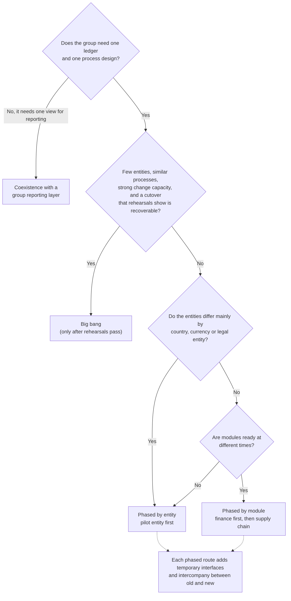

# Consolidation approaches

There are four common ways to bring several companies onto one ERP and finance platform. This page describes each one, what it demands, how it fails, and how to choose. "ERP A" and "ERP B" stand for any two existing systems and "target" for the common platform.

The first question comes before the approach: whether to consolidate at all. See [decision/README.md](../decision/README.md). The approach only matters once the answer is yes, or partly yes.

## Choosing an approach

The diagram is a starting point for a discussion, not a rule. Source: [images/approach-selection.mmd](images/approach-selection.mmd), also available as [SVG](images/approach-selection.svg).

## Comparison

| | Big bang | Phased by entity | Phased by module | Coexistence with a group reporting layer |
|---|---|---|---|---|
| What moves | Every entity and module at one cutover | One entity at a time, all modules | One module at a time, all entities | Nothing moves. Data is mapped and collected centrally |
| Duration to full benefit | Shortest | Medium to long | Medium to long | Reporting benefit early, process benefit never |
| Temporary interfaces | Few | Many (intercompany and reporting between old and new) | Many (ledger to sub-ledger links) | Permanent, by design |
| Peak risk | Very high at one weekend | Moderate, repeated | Moderate, repeated | Low |
| Parallel running cost | Short, intense | Long, low intensity | Long, low intensity | Permanent |
| Learning between waves | None | Strong | Partial | Not applicable |
| Needs strong change capacity | Yes | Yes, sustained | Yes, sustained | No |
| Typical fit | Few entities, similar processes, small data volumes | Entities that differ by country, currency or legal form | Modules that are ready at different times | Entities that must keep local systems, or a decision still open |

## Big bang

All entities and modules cut over in a single event.

Works when the group is small, processes are similar, data volumes are modest and the business can tolerate a short freeze. It avoids temporary interfaces and the long period of running two worlds.

Fails when rehearsal results are weak but the date is fixed. The risk is concentrated: if the cutover goes wrong there is no pilot entity to fall back on, and a rollback plan has to cover everything at once. Treat any big bang with no full rehearsal that passed its reconciliations as a red flag. See [cutover-plan.md](cutover-plan.md).

## Phased by entity

One company, or a small group of companies, moves at a time. A pilot entity goes first, ideally one that is representative but not the largest or the most complex.

Strengths: lessons from the pilot improve later waves, and each wave is small enough to rehearse properly. The pilot proves the target platform for a real process, which is also a gate in the [decision framework](../decision/README.md) (G04).

Costs: intercompany transactions between migrated and not-yet-migrated entities need a temporary design. Group reporting has to read from both sides until the last wave. Teams are asked to sustain effort over a long period, and the template (chart of accounts, master data standards, process design) must be frozen early enough that wave two is not a redesign.

## Phased by module

Finance moves first, then purchasing and inventory, then sales, then manufacturing, or some other order. All entities share the new ledger from the first wave.

Strengths: a single ledger and a single chart of accounts arrive early, which is often where the group reporting benefit sits. Teams meet one set of changes at a time.

Costs: the temporary interfaces between the new ledger and the old sub-ledgers are real software that must be built, tested and reconciled. Open transactions straddle the boundary: an invoice posted in the old sales module has to reach the new receivables ledger. Reconciliation between the two sides carries on until the last module moves.

## Coexistence with a group reporting layer

Each entity keeps its system. A reporting layer (a data warehouse, a consolidation tool, or a well-governed set of spreadsheets) receives mapped trial balances and, where useful, harmonised master data.

This is a legitimate end state, not a failure. It suits groups where statutory differences are large, where a sale or restructure is possible, where contracts run for years, or where change capacity is short. It also suits groups that are not sure yet: it delivers the reporting benefit and buys time without closing options.

What it still needs is exactly the mapping work in this toolkit: a group chart of accounts, a mapping per entity, reconciliations by period, and master data matching if group-level customer or supplier views are wanted. Because it never ends, the mapping becomes an ongoing control rather than a one-off project task.

## Hybrids

Real programmes mix these. A common pattern is finance first for all entities (phased by module), then supply chain by entity (phased by entity), with one entity staying on coexistence because of a local statutory constraint. State the pattern explicitly in the programme plan so that interfaces, rehearsals and reporting are planned for each combination.

## What every approach shares

- A frozen group chart of accounts and master data standard before the first load.
- Mapping and reconciliation evidence per entity (the toolkit's `map-coa` and `reconcile`).
- A named owner for each decision to merge master data (the toolkit's `dedupe` proposes, people decide).
- Rehearsal of the cutover with timings and reconciliations recorded. See [cutover-plan.md](cutover-plan.md).
- A way to read data after migration for audit and statutory purposes. See [pitfalls.md](pitfalls.md) on historical data.
