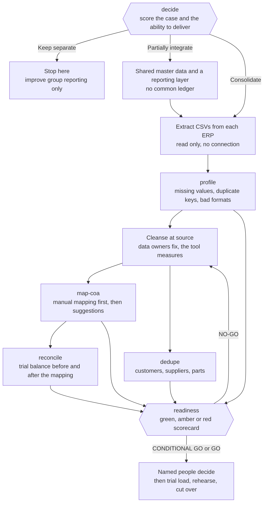

# Data migration approach

Migration is a sequence of six steps, repeated for each entity and each rehearsal: extract, cleanse, map, load, reconcile, cutover. The toolkit supports the middle steps on CSV extracts. It does not connect to any system and does not load anything.

Source: [images/toolkit-flow.mmd](images/toolkit-flow.mmd), also available as [SVG](images/toolkit-flow.svg).

## 1. Extract

Take a read-only extract from each source system, as CSV, at a stated point in time. Record the system, the entity, the time, who ran the extract, and the row counts reported by the source system, so the file can be traced.

- Extract whole tables rather than filtered views, so that quality problems are visible.
- Keep trial balances by period, not just a closing balance, for every period that will be compared.
- Keep the original files unchanged. Cleansing happens on copies.
- Note the encoding and delimiter. Systems in different countries often differ (semicolons and decimal commas are common in European exports). The toolkit detects these and reports what it found, and the examples include a Windows-1252, semicolon and decimal comma file on purpose.
- Treat extracts as personal data where they hold contact details. Store and share them accordingly. Profile reports can leave example values out (`--no-examples`).

Toolkit support: none needed, but the files must be readable. A run of `profile` on each file is the first test of that.

## 2. Cleanse

Profile first, then decide what to fix at source, what to fix in the migration and what to leave.

- `profile` reports row counts, missing values in required columns, repeated keys and failed format checks (postcode, tax number, email, date, number or a custom pattern) per column, as Markdown and JSON.
- `dedupe` finds probable duplicates within each system and across the two, and writes a merge proposal. See [scoring-models.md](scoring-models.md) for how pairs are scored.
- Decide the rules before the work: which record survives a merge, which fields are taken from the other record, what happens to inactive records, who may approve a merge.
- Cleansing at source is usually better than cleansing in transit, because the source stays the reference during parallel running. Where the source cannot be changed in time, record the transformation rules so that they can be replayed in each rehearsal.

The toolkit never changes data. The merge proposal CSV lists a suggested survivor for each group, the fields to check before merging and a proposed action. The proposal is an input to an approval step that happens outside the tool.

## 3. Map

Mapping translates source values into target values: accounts, units of measure, tax codes, payment terms, customer and supplier groups, part categories.

- `map-coa` takes the manual mapping first (treated as approved) and then suggests the rest from account type and normalised name similarity, with a confidence score. Suggestions are never approved by the tool.
- Review every suggestion, copy the accepted ones into the manual mapping file, and run again until every account that carries a balance has an approved mapping.
- Many-to-one mappings are normal in consolidation (two source accounts for one target account) but each one is flagged so that someone confirms the merge makes sense.
- A mapping between accounts of different types (for example an expense account mapped to an asset account) moves balances between classes. It may be right, but it changes reported totals, so it is flagged and shown in the reconciliation.
- Keep mapping tables for units of measure, tax codes and other value lists in the same controlled place as the chart mapping.

## 4. Load

Load into the target in dependency order: structure and settings, chart of accounts, master data, opening balances, then open transactions. The load itself is done with the target platform's own tools and is outside this toolkit.

- Load into a non-production environment first, every time.
- Record row counts loaded and rejected, with reasons.
- Decide early whether history is loaded as detail, as summary balances by period, or left in an archive. See [pitfalls.md](pitfalls.md).

## 5. Reconcile

Reconciliation is the evidence that the migration did not change the numbers.

- `reconcile` compares the source trial balance, by period, with the same balances after applying the mapping, within a tolerance. It reports unmapped balances, reclassification between account classes, and, where a trial balance from a trial load of the target is supplied, differences between that and the mapped source.
- Reconcile more than the trial balance: open receivables and payables by customer and supplier, inventory quantity and value by part and location, open purchase and sales orders, fixed asset register totals. The toolkit covers the trial balance only. The other reconciliations need the same discipline and should follow the same pattern: a control total from the source, the same total from the target, a stated tolerance, a named reviewer.
- Reconcile in every rehearsal, not only the last one. A reconciliation that has never failed in rehearsal has probably not been tested.
- Currency: the toolkit does no currency translation. Reconcile in the currency of the trial balance, and treat translation as a separate, explicit step.

## 6. Cutover

Cutover is the controlled move to the new system: a freeze, a final extract, a final load, final reconciliations, a go or no-go decision and the first transactions in the target. See [cutover-plan.md](cutover-plan.md) for the plan and the rehearsal checklist.

## Evidence to keep

For each entity and each rehearsal: the extract files with row counts, the profile and duplicate reports, the approved mapping and its approver, the reconciliation reports, the load logs, the issues found with owners, and the readiness scorecard. The `readiness` command combines the summaries into one scorecard. See [readiness-thresholds.md](readiness-thresholds.md) for what it measures and why the limits are what they are.
